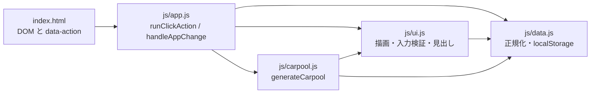

# くるまわり 完全仕様書・全体設計図

監査日: 2026-11-06。記述はリポジトリ内の実ファイルに限る。生成物ディレクトリ（`android/.gradle/`、`android/app/build/`、`android/capacitor-cordova-android-plugins/build/`、`android/build/`）はソースではないため第2章の末尾で除外範囲だけ記す。

行数は `wc -l` の結果。PNG の行数はソース行数ではない。

---

## 第1章：システム概要とアーキテクチャ全体像

### 1.1 プロダクト名

| 箇所 | 実文字列 |
| --- | --- |
| `index.html` `<title>` | `くるまわり - スポ少・部活の車出し＆配車自動作成` |
| `index.html` `<h1>` | `🚗 くるまわり` |
| `index.html` 見出し直下 `<p>` | `スポ少・部活の車出し＆配車自動作成` |
| `index.html` `apple-mobile-web-app-title` | `くるまわり` |
| `manifest.json` `name` / `short_name` | 上記フルタイトル / `くるまわり` |
| `capacitor.config.json` `appName` | `くるまわり` |
| `android/app/src/main/res/values/strings.xml` `app_name` と `title_activity_main` | `くるまわり` |
| `ios/App/App/Info.plist` `CFBundleDisplayName` | `配車ヘルパー`（iOS 表示名は Android / Web と異なる） |

`manifest.json` の `description` は `少年野球チームの配車決定とLINE共有を支援するオフライン対応アプリ`。`display` は `standalone`、`orientation` は `portrait-primary`、`start_url` は `./index.html`、`theme_color` と `background_color` は `#1e3a8a` と `#ffffff`。

### 1.2 実行形態

- ブラウザと PWA: `index.html` 末尾が `navigator.serviceWorker.register('./sw.js')` を呼ぶ。`sw.js` 先頭コメントは `Cache First Service Worker`。`CACHE_NAME` は `haisha-cache-v20261105g`。
- Android: `capacitor.config.json` の `appId` は `com.haisha.app`、`webDir` は `www`。`MainActivity` は `com.getcapacitor.BridgeActivity` を継承する空クラス。
- iOS: `ios/App/App/Info.plist` と `ios/App/App/AppDelegate.swift`、`SceneDelegate.swift` が存在する。同梱 `ios/App/App/public/js/*.js` の行数はルート `js/` より少ない（例: `data.js` 680 行対 1712 行）。
- 依存: `package.json` は `@capacitor/core` `@capacitor/cli` `@capacitor/android` `@capacitor/ios` が `^8.5.3`、`@capacitor/share` が `^8.0.3`。アプリ本体の計算ライブラリは無い。

スクリプト読み込み順は `index.html` のコメントどおり `data.js` → `ui.js` → `carpool.js` → `app.js`。クエリはすべて `?v=20261105g`。各ファイルは IIFE `(function (global) { ... })(window)` で、`HaishaData` / `HaishaUI` / `HaishaCarpool` / `HaishaApp` を `window` に置く。`data.js` と `ui.js` は公開関数を `global.<関数名>` にもコピーする。`ui.js` は `HaishaUI` の関数キーだけをコピーする。

### 1.3 データフロー



実経路:

1. クリックは `document` の委譲。`app.js` `findActionEl` が `closest('[data-action]')` を取り、`CLICK_ACTIONS` に含まれるとき `runClickAction` が動く。`change` は `handleAppChange`。
2. `data-action="generate"` は `target.dataset.rerun === '1'` なら `rerunCarpool(target)`、それ以外は `runPrimaryCarpool()`。どちらも `generateCarpool(salt)`。
3. `generateCarpool` は `children` と `cars` を読み、`buildTwoPhaseAssignment` の結果を `currentAssignments` に置く。`showPlanTexts(buildPlanTexts(assignments))` が `#resultText` を書き、`#resultCard` の `style.display` を `block` にする。
4. 永続化は `saveData()`。中で `captureActiveSlot()` のあと `localStorage` の `cp_cars`、`cp_children`、および `persistPlanStore()` を書く。

`#carpoolMode`（`balance` / `grade_same` / `grade_diff` / `position`）は `index.html` に存在する。`js/` 内に `carpoolMode` の参照は無い。配車関数は選択値を引数に取らない。

---

## 第2章：ファイル構成一覧と各ファイルの責務

ソース・オブ・トゥルースはルートの `index.html`、`js/`、`css/style.css`、`sw.js`、`manifest.json`。`www/` は Capacitor の `webDir`。`www/js/` の行数はルート `js/` と一致する。`www/` 直下の `data.js`（1712）、`carpool.js`（1310）、`ui.js`（1601）、`app.js`（447）、`style.css`（1218）は `index.html` から参照されない。`index.html` が読むのは `js/` と `css/style.css`。

### 2.1 アプリ本体

| パス | 行数 | 役割 |
| --- | --- | --- |
| `index.html` | 360 | 画面骨格、要素 ID、`data-action`、SW 登録 |
| `js/data.js` | 1712 | マスタ、日別スロット、座席式、履歴統計、バックアップ |
| `js/ui.js` | 1614 | 一覧描画、見出し、結果 HTML、入力時の残席拒否 |
| `js/carpool.js` | 1311 | 二段階配車、警告、共有文、手動移動 |
| `js/app.js` | 447 | クリック / change の振り分け、初期化 |
| `css/style.css` | 1218 | 画面スタイル |
| `sw.js` | 101 | Cache First の Service Worker |
| `manifest.json` | 32 | PWA マニフェスト |
| `package.json` | 9 | Capacitor 依存 |
| `package-lock.json` | 1156 | npm ロック |
| `capacitor.config.json` | 4 | `appId` `com.haisha.app`、`webDir` `www` |
| `ARCHITECTURE.md` | 569 | 既存の別文書。本ファイルの入力にはしていない |
| `icons/icon-192.png` | — | 192px アイコン |
| `icons/icon-512.png` | — | 512px アイコン |
| `icons/icon-1024.png` | — | 1024px アイコン |
| `assets/icon.png` | — | アイコン原寸 |
| `icon.jpeg` | — | JPEG アイコン |

### 2.2 `www/`（Capacitor 同梱コピー）

| パス | 行数 | 備考 |
| --- | --- | --- |
| `www/index.html` | 360 | ルートと同行数 |
| `www/js/data.js` | 1712 | ルートと同行数 |
| `www/js/ui.js` | 1614 | ルートと同行数 |
| `www/js/carpool.js` | 1311 | ルートと同行数 |
| `www/js/app.js` | 447 | ルートと同行数 |
| `www/css/style.css` | 1218 | ルートと同行数 |
| `www/sw.js` | 101 | ルートと同行数 |
| `www/manifest.json` | 32 | ルートと同行数 |
| `www/style.css` | 1218 | ルート直下コピー。HTML は `css/style.css` を読む |
| `www/data.js` | 1712 | 直下コピー。HTML は `js/data.js` を読む |
| `www/ui.js` | 1601 | 直下コピー。`www/js/ui.js` より 13 行少ない |
| `www/carpool.js` | 1310 | 直下コピー。`www/js/carpool.js` より 1 行少ない |
| `www/app.js` | 447 | 直下コピー |
| `www/icons/icon-192.png` | — | |
| `www/icons/icon-512.png` | — | |

### 2.3 Android 設定（ビルド出力を除く）

| パス | 行数 | 役割 |
| --- | --- | --- |
| `android/settings.gradle` | 4 | モジュール include |
| `android/build.gradle` | 29 | Android Gradle Plugin `8.13.0`、`variables.gradle` を apply |
| `android/variables.gradle` | 15 | `minSdkVersion = 24`、`compileSdkVersion = 36`、`targetSdkVersion = 36` |
| `android/gradle.properties` | 22 | Gradle プロパティ |
| `android/gradlew` | 251 | Unix ラッパ |
| `android/gradlew.bat` | 94 | Windows ラッパ |
| `android/gradle/wrapper/gradle-wrapper.properties` | 7 | Gradle `8.14.3` |
| `android/gradle/wrapper/gradle-wrapper.jar` | — | ラッパ JAR |
| `android/capacitor.settings.gradle` | 6 | Capacitor モジュール |
| `android/app/build.gradle` | 54 | `applicationId "com.haisha.app"`、`versionCode 1`、`versionName "1.0"`、`minifyEnabled false` |
| `android/app/capacitor.build.gradle` | 19 | Capacitor 生成 |
| `android/app/proguard-rules.pro` | 21 | release 用ルール。release は minify 無効 |
| `android/app/src/main/AndroidManifest.xml` | 35 | `MainActivity`、`INTERNET`、FileProvider |
| `android/app/src/main/java/com/haisha/app/MainActivity.java` | 5 | `BridgeActivity` 継承のみ |
| `android/app/src/main/res/values/strings.xml` | 7 | アプリ名 |
| `android/app/src/main/res/values/styles.xml` | 21 | テーマ |
| `android/app/src/main/res/values/ic_launcher_background.xml` | 3 | 背景色 |
| `android/app/src/main/res/layout/activity_main.xml` | 12 | 起動レイアウト |
| `android/app/src/main/res/xml/config.xml` | 5 | Cordova 設定 |
| `android/app/src/main/res/xml/file_paths.xml` | 4 | FileProvider パス |
| `android/app/src/main/assets/capacitor.config.json` | 5 | 同梱設定 |
| `android/app/src/main/assets/capacitor.plugins.json` | 6 | プラグイン一覧 |
| `android/app/src/main/assets/public/` | — | `www` 同期後の Web 資材。`js/data.js` 1712、`js/ui.js` 1614、`js/carpool.js` 1311、`js/app.js` 447、`index.html` 360、`sw.js` 101。直下にも `data.js` `ui.js` `carpool.js` `app.js` `style.css` がある |
| `android/capacitor-cordova-android-plugins/build.gradle` | 58 | プラグインモジュール |
| `android/capacitor-cordova-android-plugins/cordova.variables.gradle` | 6 | |
| `android/capacitor-cordova-android-plugins/src/main/AndroidManifest.xml` | 7 | |
| `android/local.properties` | 11 | SDK パス。環境依存 |
| `android/.gitignore` | 101 | |
| `android/app/.gitignore` | 2 | |
| `android/app/src/test/.../ExampleUnitTest.java` | 18 | テンプレートテスト |
| `android/app/src/androidTest/.../ExampleInstrumentedTest.java` | 26 | テンプレートテスト |

ランチャとスプラッシュは `android/app/src/main/res/` の `mipmap-*`（`ic_launcher.png`、`ic_launcher_round.png`、`ic_launcher_foreground.png`、`ic_launcher_background.png`、`mipmap-anydpi-v26/ic_launcher.xml`、`ic_launcher_round.xml`）と `drawable*` の `splash.png`（`land` / `port` / `night` と ldpi〜xxxhdpi）、`drawable/ic_launcher_background.xml`、`drawable-v24/ic_launcher_foreground.xml`。

### 2.4 iOS

| パス | 行数 | 役割 |
| --- | --- | --- |
| `ios/App/App/Info.plist` | 70 | `CFBundleDisplayName` = `配車ヘルパー` |
| `ios/App/App/AppDelegate.swift` | 44 | 起動 |
| `ios/App/App/SceneDelegate.swift` | 24 | シーン |
| `ios/App/App/Base.lproj/Main.storyboard` | 19 | |
| `ios/App/App/Base.lproj/LaunchScreen.storyboard` | 32 | |
| `ios/App/App/capacitor.config.json` | 8 | 同梱設定 |
| `ios/App/App/config.xml` | 5 | |
| `ios/App/App.xcodeproj/project.pbxproj` | 382 | Xcode プロジェクト |
| `ios/App/CapApp-SPM/Package.swift` | 27 | Swift Package |
| `ios/App/CapApp-SPM/Sources/CapApp-SPM/CapApp-SPM.swift` | 1 | |
| `ios/App/App/public/js/data.js` | 680 | ルート 1712 行より古い同梱 |
| `ios/App/App/public/js/ui.js` | 933 | ルート 1614 行より古い同梱 |
| `ios/App/App/public/js/carpool.js` | 665 | ルート 1311 行より古い同梱 |
| `ios/App/App/public/js/app.js` | 332 | ルート 447 行より古い同梱 |
| `ios/App/App/public/index.html` | 296 | ルート 360 行より古い同梱 |
| `ios/App/App/public/css/style.css` | 838 | ルート 1218 行より古い同梱 |
| `ios/debug.xcconfig` | 1 | |
| `ios/.gitignore` | 13 | |

アイコンとスプラッシュは `ios/App/App/Assets.xcassets/`（`AppIcon.appiconset`、`Splash.imageset`）。

### 2.5 除外した生成物

`android/.gradle/`、`android/app/build/`（`outputs/apk/debug/app-debug.apk` を含む）、`android/capacitor-cordova-android-plugins/build/`、`android/build/`。

---

## 第3章：データモデルおよび永続化仕様（`js/data.js`）

メモリ上のマスタは `cars` と `children`。`saveData` が `cp_cars` と `cp_children` に `JSON.stringify` する。日別の出欠・結果は別キー。

### 3.1 ストレージキー

| キー | 定義 | 内容 |
| --- | --- | --- |
| `cp_cars` | `loadData` / `saveData` | 車両マスタ配列 |
| `cp_children` | 同上 | 選手マスタ配列 |
| `cp_driver_roles` | `DRIVER_ROLES_KEY` | 運転者ラベル配列 |
| `cp_companion_roles` | `COMPANION_ROLES_KEY` | 同乗者ラベル配列 |
| `cp_avoid_pairs` | `getAvoidPairs` | `[[idA, idB], ...]` |
| `cp_dispatch_period` | `DISPATCH_PERIOD_KEY` | `30` / `90` / `180`。読めなければ `90` |
| `cp_plan_sessions` | `PLAN_INDEX_KEY` | `{ version: 2, active, dates }` |
| `cp_session_${ymd}` | `sessionStorageKey` | その日のスロット JSON。`ymd` は `YYYY-MM-DD` |
| `cp_day_slots` | `PLAN_SLOTS_KEY` | 旧週末スロット。読み取り後に削除する経路がある |
| `cp_tutorial_seen` | `TUTORIAL_SEEN_KEY` | `'1'` で既読 |
| `cp_child_sort` | `ui.js` `CHILD_SORT_KEY` | `default` / `kana` / `grade` / `position`。`sessionStorage` |
| `cp_car_sort` | `ui.js` `CAR_SORT_KEY` | `default` / `kana`。`sessionStorage` |
| `cp_lastSessionCommit` | `carpool.js` | 直近の履歴加算マップ |
| `cp_lastDispatchCommit` | `carpool.js` | 直近の出動確定 |

`cp_session_` の中身は `emptyPlanSlot` の形を `sanitizeStoredSlot` したもの。

```javascript
{ date, cars: {}, children: {}, result: null, sessionCommit: null, dispatchCommit: null }
```

`result` は `captureLiveResult` の戻り値。`#resultCard.style.display === 'block'` のときだけ作り、形は `{ assignments: { [車名]: [選手id, ...] }, warnings: string[] }`。`warnings` は `HaishaCarpool.assignmentWarnings`。開いていなければ `null`。

`cars[id]` と `children[id]` の日別差分は `snapshotLiveIntoSlot` が書く。車両日別の初期値 `defaultCarDaily` は `{ active: true, companions: [], isEquipmentCar: false, driverRole: '父', dayMode: 'normal' }`。選手日別の初期値 `defaultChildDaily` は `{ active: true, meetOnSite: false, dayMode: 'normal', companions: [], fixedCar: '' }`。

### 3.2 正規化

`normalizeCompanion(item, fallbackId)` はオブジェクト以外、または `label` が空なら `null`。戻りは `{ id: item.id != null ? item.id : fallbackId, label }`。

`normalizeCar(car)` の戻りフィールドは `id`, `name`, `capacity`（0 未満は 0）、`active`, `companions`, `isEquipmentCar`, `driverRole`, `dayMode`, `dispatchHistory`。`companions` が空で `familySeats` が正なら、その人数だけ `{ id: 'legacy-family-${car.id}-${i}', label: '身内' }` を作る。

`normalizeDayMode` は `'direct'` と `'individual'` 以外を `'normal'` にする。

`normalizeChildCompanions(child)` は配列なら各要素を `normalizeCompanion(..., 'ch-cmp-${child.id}-${idx}')`。配列が無く `meetOnSite` が偽かつ `guardianRide` が真なら `[{ id: 'legacy-guardian-${child.id}', label }]`。`label` は `guardianName` の trim、空なら `'母'`。

`normalizeChild(child)` は `dayMode === 'normal' && meetOnSite` なら `dayMode = 'direct'`。`direct` は `meetOnSite = true`。`individual` は `meetOnSite = false`。`companions` は `meetOnSite` または `dayMode === 'individual'` なら `[]`、それ以外は `normalizeChildCompanions` の結果。残すフィールドはスプレッドに加え `active`, `meetOnSite`, `dayMode`, `companions`, `motionSick`, `parentCar`, `fixedCar`, `lastCar`, `rideHistory`（非配列オブジェクトでなければ `{}`）。

初期サンプル `createDefaultCars` は佐藤号定員 3、鈴木号定員 3、田中号定員 2。`createDefaultChildren` は id 1〜6（ゆうと、そうた、れん、はると、こうき、大和）。保存済みデータがある端末では `loadData` がそれを使う。

ラベル初期値: 運転者 `['父', '母', '祖父', '祖母', '指導者', 'その他']`、同乗者 `['母', '父', '兄', '弟', '妹']`。`ROLE_LABEL_MAX` は 20。`migrateRoleLabels` は旧デフォルト（運転者に「指導者」が無い配列、同乗者が同じ 5 語）のときだけ新デフォルトへ置換する。`LEGACY_TEST_ROLE_LABELS` は `['看護師', '添乗員', '職員']`。

### 3.3 親子判定 `isChildOfCar(child, car)`

引数のいずれかが無い、または車名 trim が空なら `false`。順に真ならそこで `true`。

1. `String(child.parentCar).trim() === carName`
2. `String(child.fixedCar).trim() === carName`
3. `carName.replace(/号$/, '').trim()` を `baseFamilyName` とし、空でなければ `child.name` が `baseFamilyName` で始まる、または `String(child.familyName).trim() === baseFamilyName`

`applyFamilyIndividual(car, on)` は `familyLinkLock` 中は戻る。`on` なら車の `dayMode` を `'individual'`、偽なら `'normal'`。`isChildOfCar` が真の選手へ `setAttendMode(child, on ? 'hold' : 'ride')` を呼び、その前後で `fixedCar` と `parentCar` を戻す。

`needsPoolSeat(child)` は `isRiding` が偽なら `false`。個人状態の車に `isChildOfCar` が真なら `false`。`parentCar` の車が `isDirectCar` なら `false`。それ以外は `true`。

`isRiding` は `childDayMode === 'normal'`。`childDayMode` は未参加なら `'off'`、`individual`、`direct` または `meetOnSite`、それ以外 `'normal'`。

### 3.4 座席式

`carCompanionSeats(car)` は `car.companions.length`。配列でなければ 0。`companionSeatsOf` と `familySeatsOf` はこれを返す。

`seatCost(child)`:

- `!child` または `!isRiding(child)` なら `0`
- それ以外は `1 + child.companions.length`（配列でなければ 0）

`calculateCarRemainingSeats(car, assignedKids)`:

```text
cap = parseInt(car.capacity, 10) || 0
companionUsed = carCompanionSeats(car)
kidsUsed = sum(seatCost(kid) for kid in assignedKids)
return cap - companionUsed - kidsUsed
```

`remainingSeats(car, assignments)`（`carpool.js`）は `assignments[car.name]` を渡してこの関数を呼ぶ。

`ridersCountedForCar(car)` は `#resultCard.style.display === 'block'` かつ `currentAssignments` があるとき、その車の配列（キーが無ければ `[]`）。閉じていれば `getFixedRidersForCar`（`isRiding` かつ `fixedCar === carName`）。

`carSeatSummary` の `guests` は `ridersCountedForCar` の `seatCost` 合計。`used = companions + guests`。`remaining` は `calculateCarRemainingSeats(car, riders)`。`isFull` は `remaining <= 0`、`isOver` は `remaining < 0`。

`canFitOnCar(car, extraSeats, excludeChildId)` は、その車の集計対象から `excludeChildId` を除いた残席が `extraSeats` 以上か。

`addChildCompanion` は残席が 1 未満なら追加しない。`setChildFixedCar` は、対象を除いた残席が `seatCost`（その選手を `dayMode: 'normal'` とみなしたコピー）未満なら指定しない。

### 3.5 履歴 `getRideHistoryStats(currentDateStr, maxSessions)`

戻りは `{ lastCar, carRideCount }`。失敗時と、`limit` が 0 または日付が `YYYY-MM-DD` でないときは両方空オブジェクト。

日付の集め方: `planStore.sessions` のキーと、`localStorage` のキーが `cp_session_` で始まるもの。`ymd >= current` は捨てる。降順に並べ `slice(0, limit)`。

呼び出しは `loadRideHistoryStats` の `getRideHistoryStats(date, 3)`。`date` は `getPlanSlotView().date`。対象は「今日より前のセッション日付のうち新しい最大 3 件」であり、暦の連続 3 日固定ではない。

各セッションの `assignments` は車名 → id 配列。同一選手・同一車は 1 回。`lastCar[pid]` は未設定のときだけ書くので、新しい日付が先に入る。`carRideCount[pid][carName]` は件数。

`rideRepeatPenalty(kid, car)`（`carpool.js`）:

- `isChildOfCar(kid, car)` が真、または `fixedCar` が車名と一致すれば `0`
- `lastCar[pid] === carName` なら `-300`
- `carRideCount[pid][carName]` を `times` として `-80 * times`
- 両方成立すれば加算

出動回数の画面集計は別関数 `getCarDispatchCount(car, days)`。`dispatchHistory` の日付を `getDispatchPeriod()`（既定 90、選択肢 30 / 90 / 180）で数える。

### 3.6 同乗配慮

`getAvoidPairs` は `cp_avoid_pairs` を parse。配列でなければ `[]`。`addAvoidPair(idA, idB)` は欠落または `idA === idB` なら戻る。順序違いの既存があれば追加しない。`isAvoidPair(kidA, kidB)` は `String(id)` で両順を比較する。

---

## 第4章：配車アルゴリズム（`js/carpool.js`）

`currentAssignments` は `{ [車名]: Kid[] }`。`warnings` は `attachAssignmentWarnings` が `Object.defineProperty(..., { enumerable: false })` で付ける。`JSON` 列挙には出ない。`lastAssignmentWarnings` が画面用の配列。

### 4.1 `generateCarpool(rerunSalt)`

`normalizeRerunSalt` は正の有限整数以外を 0 にする。`runPrimaryCarpool` は日付キーの salt を 0 にして `generateCarpool(0)`。`rerunCarpool` は salt を 1 足して渡す。

処理順:

1. `excludePlayersOfIndividualCars()`
2. `assignDirectFamilies()`。現地車（`isDirectCar`）に、`isRiding` かつ `parentCar === car.name` で、残席が `seatCost` 以上かつ `hasAvoidPairConflict` が偽の選手を載せる
3. プール対象は `isRiding`、現地配置済みでない、個人状態でない、個人車の子でない選手
4. 乗車・現地・個人の人も車も無ければ alert して return
5. 乗車選手がいてプール車が 0 なら `presentCarpoolFailure`
6. `totalCap < seatDemand` なら不足席数で alert。`seatDemand = sum(seatCost) + sum(familySeatsOf)`。`familySeatsOf` は車両同乗者数
7. `poolCars.length * 2 > ridingKids.length` なら警告文 `車両数が多いため、1名乗車の車両が発生します` を積む。配車自体は止めない
8. `buildTwoPhaseAssignment`。`overflowedCars` があれば alert。`leftover` が残れば失敗診断へ
9. `collectSoftWarnings` を足し、`showPlanTexts`、`showResultPattern(salt)`、`renderCars`

1 台 2 名はハード拒否ではない。`carsToUse = min(activeCars.length, max(1, floor(ridingKids.length / 2)))` は空車を優先して埋める台数の上限として `chooseCarForFreeKid` が使う。評価では `totalRiders >= activeCars.length * 2` のとき 1 名車に `-1000`。

### 4.2 フェーズ 1 `buildTwoPhaseAssignment(activeCars, ridingKids, rerunSalt)`

最初に `loadRideHistoryStats()`。車名ごとに空配列。

1. `fixedCar` がプール車にあり、`remainingSeats >= seatCost(kid)` かつ配慮衝突が無ければその車へ `push`。残席不足のときだけ車名を `overflowedCars` に入れる。配慮衝突だけなら overflow に入れずフリーへ回す
2. 固定が別車に残っていない選手で `parentCar` がプール車にあり、同じ残席・配慮条件を満たせば親の車へ。満たさなければフリー
3. フリーをソート。キーは `motionSick` 降順、`seatCost` 降順、`freeKidRank` 昇順
4. `freeKidRank` は FNV 系 `hashSeedKey`。salt 0 の種は `` `${date}\0${id}` ``。salt が正なら `` `${date}_salt${salt}_${id}` ``
5. 各選手を `chooseCarForFreeKid`。候補は残席が `seatCost` 以上で配慮衝突が無い車。優先は 1 名乗車の車、次に `carsToUse` 未満なら空車、次に使用中、最後に残った適合車。同人数なら `preferCar`。`motionSick` は定員が大きい車、それ以外は定員が小さい車
6. 余りは `repairLeftovers`。スワップ可能な選手を一度外し、空いた席に余りが乗り、外した選手が別車に乗れるときだけ確定
7. 余りが空なら `optimizeBySwaps`

### 4.3 フェーズ 2

`isSwappable` は、`fixedCar` または `parentCar` がそのプール車名と一致する選手を除外する。

`canSwapSeats(carA, kidA, carB, kidB, assignments)` は入れ替え後の配列を作る。相手側の残りメンバーと入れ替え相手に `hasAvoidPairConflict` があれば `false`。両方 `calculateCarRemainingSeats(...) >= 0` で `true`。

`optimizeBySwaps` は `MAX_SWAP_TRIALS = 280`。車ペアを総当たりし、salt が正ならペア列と走査開始位置を `salt % length` でずらす。スコアが `before + 1e-6` より大きければ採用。`salt > 0` かつ差の絶対値が `1e-6` 以下でも採用する。それ以外は元に戻す。

salt が正でプール車が 2 台以上のとき、`optimizeBySwaps` のあとにもう一段ある。スワップ可能な異車ペアのうち `canSwapSeats` が真のものから `(salt - 1) % candidates.length` 番目を無条件で入れ替える。候補が 0 なら何もしない。

### 4.4 `evaluateAssignmentScore(assignments)`

高いほど良い。減点は次のとおり。

| 条件 | 点 |
| --- | --- |
| 1 名車（全体人数が台数の 2 倍以上のとき） | `-1000` |
| 投手 2 人以上 | `-150 * 人数`。投手は `pos` が `投手` / `P` / `ピッチャー` |
| 捕手 2 人以上 | `-150 * 人数`。捕手は `捕手` / `C` / `キャッチャー` |
| 定員が `medianCapacity` 未満の車に `motionSick` | 1 人 `-200` |
| `rideRepeatPenalty` | 上記 `-300` と `-80 * times`。親車・固定は 0 |
| 同一車の `isAvoidPair` | ペアごとに `-50000` |
| 学年平均の分散 | `-variance * 30`（車が 2 台以上で、各車は在籍者の `grade` 平均） |

`medianCapacity` は定員を昇順にし、奇数なら中央、偶数なら中央 2 つの平均。

`collectSoftWarnings` は 1 名乗車、投手重複、捕手重複、定員が中央値未満かつ `motionSick` の文を返す。配慮ペアの文言はここには無い。

失敗時 `diagnoseCarpoolFailure` は `needsPoolSeat` の `seatCost` 合計と車両同乗者席を比べ、車両同乗者の解除、選手同乗者の削減、休止車の出勤、現地集合を提案する。表示先は `#carpoolDiagnosis`。

### 4.5 見出しと共有文

`formatCarCompanionHeader(car, riders)` は `ui.js`。`riders` 省略時は選手同乗者なし。

1. `driverRole` を trim
2. `companionsOf(car)` の `label`。運転者と同じ文字は除く
3. 各 rider の `childCompanionsOf`。空ラベルは捨て、`選手名 + ラベル`（区切り文字なし。例の形は `はると` + `弟` = `はると弟`）
4. 運転者があれば `[運転者, ...車両同乗, ...選手同乗]`、無ければ同乗者だけ。空なら `''`。あれば `（` + `、` 結合 + `）`

`buildPlanTexts(assignments)` の戻りは `{ screen, line }`。画面が使うのは `line`（`showPlanTexts` が `lastGeneratedPlan = texts.line`）。`screen` を読む箇所は `buildPlanTexts` 内だけ。

プール車の `line` は

```text
■ ${車名}${header}${isEquipmentCar ? ' 【道具車】' : ''}
${lineNames.join('、') または 'なし'}
```

`lineNames` は `k.name` のみ。`screen` 側の道具車は ` 【道具車📦】`、乗車行は `playerListLabel`（`📌` と `🤢` と名前。同乗者ラベルは付けない）。

続けて未割当、`directSectionLines`（見出し `■ 現地集合（直行）`。現地車は `・車名（運転者）：選手（自走直行）`、現地選手は `・名前（現地合流）`）、`holdSectionLines`（見出し `■ 個人（家庭送迎・自走）`。個人車は `formatCarCompanionHeader(car)` に riders を渡さないので車両同乗者だけ）。末尾は `よろしくお願いいたします！`。`screen` だけ、固定があればピン注記、車酔いがいれば `🤢` 注記。

結果カードの選手行 `buildRiderMoveRow` は `📌`（`fixedCar` がその車）と `🤢` と `kid.name` と suffix。`（＋弟）` は付けない。見出しは `formatCarCompanionHeader(car, riders)`。

---

## 第5章：UI 結線（`index.html` と `js/ui.js` / `js/app.js`）

ボタンの多くに `id` は無い。振り分けは `data-action`。

### 5.1 配車・日付・結果

| 画面 | 実体 | 動作 |
| --- | --- | --- |
| 配車を組む | `<button data-action="generate">`。id は無い | `runPrimaryCarpool` → salt 0 |
| 再計算 | 同じ `data-action="generate"` かつ `data-rerun="1"`。`#resultCard` の中。初期 CSS `.result-card { display: none }` | `rerunCarpool`。salt を加算。ボタン文言を一時的に `パターン ${next + 1} を生成しました` |
| 共有 | `data-action="copy-result"`。id は無い | `copyResult`。`shareDispatchText(lastGeneratedPlan)`。履歴確定も行う |
| 日付 | `#planDateInput` `data-action="set-plan-date"` | `setActivePlanDate` |
| 前日 / 翌日 | `data-action="shift-plan-date"` `data-delta="-1"` / `"1"` | `shiftPlanDate` |
| 今日 | `data-action="go-plan-today"` | `goToPlanToday` |
| 表示ラベル | `#planDateLabel` | `syncPlanDayBar` |

`#btnAutoAssign`、`#btnRerun`、`#btnCopyResult`、`#targetDatePicker` は `index.html` に存在しない。

結果:

| ID | 役割 |
| --- | --- |
| `#resultCard` | `showPlanTexts` が `display='block'` |
| `#resultHeading` | `planResultHeading()`。無ければ `本日の配車結果` |
| `#resultPattern` | `showResultPattern`。salt が 0 以下なら `hidden` と空文字。正なら `パターン ${salt + 1}（再計算）` |
| `#resultWarnings` | `renderAssignmentWarnings`。空なら `hidden` |
| `#resultText` | 移動行 HTML と `<pre class="result-share-preview">` |
| `#carpoolDiagnosis` | 失敗診断。初期 `hidden` |

状態バー: `#statusBar` `#countKids` `#countOnSite` `#countSeats` `#statusDiffLabel` `#statusDiff`。`updateStatusBar` は参加人数、現地人数、プール車定員、需要との差。需要は `needsPoolSeat` の `seatCost` 合計に、現地車で乗り切れない家族の `seatCost` と、プール車の `carCompanionSeats` を足す。

### 5.2 一覧と設定

| ID / 属性 | 動作 |
| --- | --- |
| `#carsPanel` `data-section="cars"` | 開閉は `toggle-section`。状態キーは `ui.js` のセクション保存 |
| `#carList` | `renderCars` |
| `#carSortToggleBtn` `toggle-car-sort` | `default` と `kana` |
| `#newCarName` `#newCarCapacity` | 追加。初期定員 value `3` |
| `#childrenPanel` | 選手 |
| `#childList` | `renderChildren` |
| `#childSortModeSelect` | `change-child-sort` |
| `#newChildName` `#newChildGrade` `#newChildPos` `#newChildParentCar` `#newChildMotionSick` | 選手追加 |
| `#carpoolMode` | DOM のみ。JS 未参照 |
| `#settingsPanel` | `toggle-settings` |
| `#dispatchPeriodSelect` | `set-dispatch-period`。option value `30` `90` `180` |
| `#btnToggleRoleMaster` `#roleMasterContainer` `#driverRoleTags` `#driverRoleInput` `#companionRoleTags` `#companionRoleInput` | ラベル編集 |
| `#btnToggleAvoidPairs` `#avoidPairsContainer` `#avoidKidSelectA` `#avoidKidSelectB` `#btnAddAvoidPair` `#avoidPairList` | 配慮ペア。登録は `addAvoidPair(kidA.id, kidB.id)` |
| `#tutorialModal` `#tutorialTitle` `#tutorialDots` `#tutorialPrevBtn` `#tutorialNextBtn` `#tutorialStartBtn` | 使い方。既読は `cp_tutorial_seen` |
| `#restoreModal` `#restoreJson` | バックアップ貼り付け |
| `#editModal` `#editChildId` `#editChildName` `#editChildGrade` `#editChildPos` `#editChildParentCar` `#editChildFixedCar` `#editChildMotionSick` | 選手編集 |

ヘッダ操作: `open-tutorial`、`reset-today`（その日の出欠だけ。ボタン文言は「この日の配車をリセット」）、`manual-save`。

車両カードの操作は `renderCars` が付ける `data-action`: `toggle-car`、`rename-car`、`move-car-up`、`move-car-down`、`update-capacity`、`delete-car`、`toggle-equipment`、`toggle-day-mode`（`data-kind="car"`）、`set-car-driver`、`add-companion`、`add-companion-custom`、`remove-companion`。

選手行: `set-attend`（`off` / `ride` / `site` / `hold`）、`toggle-day-mode`（`data-kind="child"`、`direct` と `individual`）、`open-child-companion`、`add-child-companion`、`remove-child-companion`、`set-fixed-car`、`edit-child`、`delete-child`。結果の移動は `move-rider`。

`setAttendMode(child, 'site'|'hold'|'off')` は `companions` を `[]` にする。`ride` は消さない。

個人トグルは `applyFamilyIndividual`。車を個人にすると `isChildOfCar` の選手も `hold`。選手を `hold` にすると紐づく車も個人。`ride` に戻すと、個人状態だった紐づき車を `normal` に戻す。

`addChildCompanion(childId, label)` は `isRiding` で名前が空でないこと。`seatCarForChild` は、結果が開いていればその選手がいる車、無ければ `fixedCar` の車。残席が 1 未満なら alert して戻る。通れば `{ id: newCompanionId(), label }` を `push` し `saveData`。

`moveAssignedPlayer` は配慮衝突なら `alert('同乗配慮のため、同じ車には指定できません。')`。残席不足なら定員超過の alert。この alert は共有文には入らない。

`css/style.css` は 1218 行。結果カード初期非表示、`#avoidPairsContainer[hidden]` と `#roleMasterContainer[hidden]` の `display: none !important`、座席バッジ、チュートリアルを含む。

---

## 第6章：ビルド・デプロイ・運用

### 6.1 Service Worker

`sw.js` は同一オリジンの GET だけ扱う。手順は次のとおり。

1. `caches.open('haisha-cache-v20261105g')`
2. リクエスト、クエリを消した URL、`ignoreSearch: true` の順で `cache.match`
3. ヒットすればそれを返す
4. 無ければ `fetch`。`response.ok` なら `cache.put`
5. ネットワーク失敗かつ `request.mode === 'navigate'` なら `./index.html` または `./`

`install` は `PRECACHE_URLS`（`./`、`index.html`、css、4 本の js、`manifest.json`、アイコン 2 つ、および `?v=20261105g` 付きの css と js）を `addAll`。失敗した URL は 1 件ずつ再試行。その後 `skipWaiting`。`activate` は `CACHE_NAME` 以外のキャッシュを `delete` し `clients.claim()`。

HTML / JS / CSS を変えたときは `index.html` の `?v=` と `sw.js` の `CACHE_NAME` および `PRECACHE_URLS` の `?v=` を同じ文字列にする。現在値は `20261105g`。同じ `CACHE_NAME` のまま中身だけ変えても、既存キャッシュの URL は置き換わらない。

### 6.2 Capacitor と Android

`webDir` は `www`。同期コマンドはリポジトリ内のスクリプトには無い。Capacitor 8 の配置先は `android/app/src/main/assets/public/` で、現在の `js/*.js` 行数は `www/js` と一致する。

デバッグ APK の Gradle タスクは `assembleDebug`。設定上の出力は `android/app/build/outputs/apk/debug/`。この監査時点で `app-debug.apk` と `output-metadata.json` がそのディレクトリにある。`versionName` は `1.0`、`minSdkVersion` は 24、`targetSdkVersion` は 36。権限は `INTERNET` のみ。

iOS の `public/` は第 2 章のとおりルートより古い。`CFBundleDisplayName` は `配車ヘルパー` のまま。

共有は `shareDispatchText`。先にクリップボードへ書き、`window.Capacitor.Plugins.Share.share` があればそれ、無ければ `navigator.share`、どちらも無ければ alert `クリップボードにコピーしました`。キャンセル（`AbortError` またはメッセージに `cancel`）はエラーにしない。

### 6.3 バックアップ

`buildBackupPayload()` の戻り:

```javascript
{ version: 3, exportedAt: new Date().toISOString(), cars, children, planSessions: cloneData(planStore) }
```

`copyBackupData` はこれをインデント 2 の JSON にして `copyTextToClipboard`。成功 alert は「バックアップ用テキストをコピーしました！…」。

復元は `#restoreJson` の文字列を `restoreBackupData`。空文字は alert して `false`。`version`、`cars`、`children` を検証し、`isBackupCar` / `isBackupChild`（名前が空でなく `id` がある）を通したものだけ採用する。`planSessions` があれば日別ストアも戻す。

`resetAllData` は初期サンプルへ戻す経路。`data-action="reset-data"` のボタン文言は「データを完全に初期化（初期サンプルに戻す）」。

---

## 付録：名前空間

| グローバル | ファイル | 役割 |
| --- | --- | --- |
| `HaishaData` | `js/data.js` | マスタと永続化の公開面。同名関数を `window` にも置く |
| `HaishaUI` | `js/ui.js` | 描画。関数キーを `window` にコピー |
| `HaishaCarpool` | `js/carpool.js` | 配車。`assignmentWarnings` を `captureLiveResult` が読む |
| `HaishaApp` | `js/app.js` | 初期化 |
| `cars` / `children` | `data.js` | メモリ上のマスタ |
| `currentAssignments` / `lastGeneratedPlan` | `carpool.js` | 開いている配車と共有文字列 |
